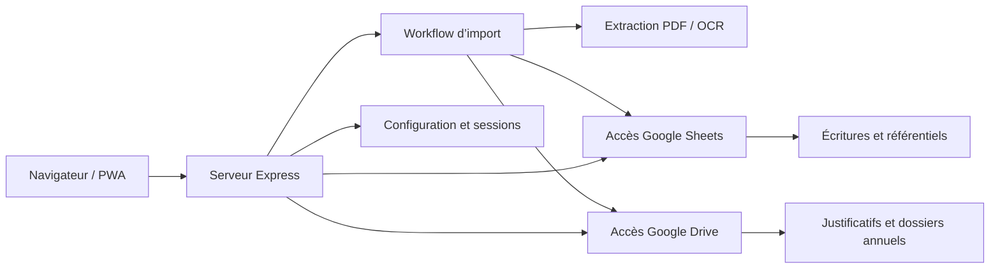
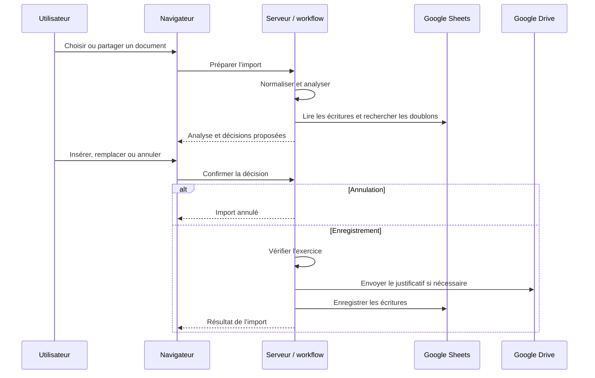

# Architecture de ComptaInf

Ce document décrit l’implémentation actuelle. Les règles de développement et les
précautions à respecter sont définies dans [AGENTS.md](./AGENTS.md).

## Vue d’ensemble

ComptaInf est une application de comptabilité avec justificatifs pour une activité
infirmière indépendante. Le navigateur communique avec un serveur Express unique.
Google Sheets conserve les écritures et les référentiels ; Google Drive conserve
les justificatifs. Des fichiers JSON locaux complètent la configuration.



Il n’existe pas de base SQL, de compilation frontend ni de framework d’interface.
Le serveur contient encore une part importante de la logique métier et plusieurs
chemins d’import coexistent.

## Organisation des modules

### Interface navigateur

| Élément | Responsabilité |
| --- | --- |
| [index.html](./index.html) | Structure principale, modales et chargement des scripts |
| [views/](./views/) | Fragments HTML injectés dans la zone de contenu |
| [navigation.js](./js/navigation.js) | Navigation, chargement des vues, sélection du contexte et traitement Drive |
| [dashboard.js](./js/dashboard.js) | Tableau de bord, statistiques de synthèse, dépôt de documents et traitements périodiques |
| [depense.js](./js/depense.js) | Saisie, prévisualisation, décisions d’import et doublons |
| [operations.js](./js/operations.js) | Liste et édition des opérations |
| [stats.js](./js/stats.js) | Statistiques et filtres de périodes |
| [mileage.js](./js/mileage.js) | Interface des frais kilométriques |
| [professional-expenses.js](./js/professional-expenses.js) | Présentation des frais professionnels |
| [pdf-preview.js](./js/pdf-preview.js) | Prévisualisation PDF |
| [share.html](./share.html) | Traitement d’un document partagé |
| [design_v1.css](./css/design_v1.css) | Style principal, adaptation aux petits écrans et modales |

Les scripts sont classiques : fonctions globales, événements et appels `fetch`.
L’ordre de chargement et les noms appelés par le HTML font partie des dépendances
de l’interface. Les données des vues sont principalement chargées par les API.

### Serveur et intégrations

| Élément | Responsabilité |
| --- | --- |
| [server.js](./server.js) | Serveur HTTP sur le port 3000, sessions, routes, imports, exports et nettoyage |
| [public-assets.js](./public-assets.js) | Liste explicite des ressources accessibles sans authentification |
| [config.js](./js/config.js) | Utilisateurs, environnement actif, exercice et configuration des ressources |
| [oauth.js](./js/oauth.js) | Client OAuth Google partagé par les modules serveur |
| [sheets.js](./js/sheets.js) | Lecture et écriture des feuilles Google Sheets avec un compte de service |
| [drive.js](./js/drive.js) | Accès Drive avec les jetons OAuth de l’utilisateur |
| [importDocument.js](./js/importDocument.js) | Préparation du justificatif et envoi vers Drive |
| [ocr.js](./js/ocr.js) | Extraction, reconnaissance de texte et application des règles métier |
| [ceesv.js](./js/ceesv.js) | Création des recettes CEESV et rapprochement UBS |
| [utils.js](./utils/utils.js) | Normalisation de dates et fournisseurs, conversion d’images |
| [upload-server.js](./upload-server.js) | Serveur auxiliaire de téléversement sur le port 3001 |

Le dossier [js/](./js/) mélange modules Node.js et scripts navigateur. Seuls les
fichiers explicitement autorisés sont publiés ; le dossier entier doit rester privé.

## Données et contexte utilisateur

### Configuration locale

`DATA_DIR` sélectionne le dossier privé ; sa valeur par défaut est `data/`
à la racine du projet. Il contient notamment :

- `settings.json` : ressources Google par environnement DEV ou PROD ;
- `users.json` : utilisateurs, rôles, environnement et exercice ;
- `oauth-client.json` : configuration OAuth ;
- `tokens.json` : jetons indexés par adresse électronique ;
- `service-account.json` : identifiants du compte de service Sheets ;
- `uploads/` : documents temporaires reçus par le serveur.

Les structures non confidentielles sont illustrées par
[settings.template.json](./settings.template.json) et
[users.template.json](./users.template.json). Le code lit ces fichiers directement ;
il ne faut pas supposer qu’un fichier `.env` est chargé automatiquement.

### Authentification

La connexion passe par les routes `/login` et `/oauth/callback`. Le serveur
récupère l’identité Google, enregistre les jetons localement et conserve l’adresse
électronique dans une session `express-session`.

Le middleware `requireAuth` protège les routes qui le déclarent. Les options de
connexion de développement sont désactivées par défaut et vérifient l’adresse
réseau du client. Il n’existe pas de protection globale garantissant que toute
route métier passe automatiquement par ce middleware.

Le stockage de session est celui en mémoire fourni par défaut par
`express-session`. Un redémarrage invalide les sessions en mémoire. Le client
OAuth est partagé et ses identifiants sont modifiés selon l’utilisateur : la
concurrence entre plusieurs utilisateurs reste un point de vigilance.

### Google Sheets

La configuration d’environnement sélectionne `SpreadsheetId` pour les opérations
et `SpreadsheetIdConfig` pour les référentiels. Cette sélection ne crée pas
automatiquement une feuille distincte pour chaque utilisateur ou exercice.

Les référentiels comprennent les catégories, fournisseurs, conversions de noms,
règles OCR et paramètres. L’exercice existe aussi dans la configuration utilisateur ;
les deux sources doivent rester cohérentes.

La feuille `DEPENSES` utilise ce contrat de colonnes :

| Colonne | Valeur |
| --- | --- |
| A | Date |
| B | Fournisseur |
| C | Catégorie |
| D | Compte |
| E | Montant signé |
| F | Justificatif principal |
| G | Type d’opération |
| H | Commentaire |
| I | Justificatif bancaire |
| J | Vide dans les ajouts actuels |
| K | Date d’import |
| L–M | Vides dans les ajouts actuels |
| N | Litres |

Les lectures incluent la ligne d’en-tête. Les numéros physiques de lignes sont
donc égaux aux indices retournés plus un. Les recettes sont positives et les
dépenses négatives.

Les ajouts simples utilisent `values.append`. Les remplacements utilisent une
requête `batchUpdate` combinant ajout et suppressions, via `replaceDepenses`.
Dans ce dernier chemin, les dates sont des nombres sériels Sheets accompagnés
d’un format DATE, afin d’éviter les dates enregistrées comme texte.

### Google Drive

Les justificatifs sont classés sous la racine configurée, dans un dossier d’année,
puis dans le dossier `FolderJustificatifs`. L’année utilisée par
[importDocument.js](./js/importDocument.js) provient des paramètres Sheets.

Le résultat de l’envoi contient un identifiant Drive et un lien de consultation.
Le transfert ferme les flux et tente de supprimer le fichier local dans son bloc
de nettoyage, y compris après une erreur : une reprise ne peut donc pas toujours
compter sur la présence du document temporaire.

## Workflow d’import principal

L’orchestrateur est [importWorkflow.js](./js/import/importWorkflow.js).
Le contexte est défini dans [workflowContext.js](./js/import/workflowContext.js).



| Étape | Module | Résultat |
| --- | --- | --- |
| Normalisation | [normalizeStep.js](./js/import/normalizeStep.js) | Type, format et métadonnées d’entrée |
| Analyse | [analyseStep.js](./js/import/analyseStep.js) | Données comptables et résultat OCR ou CSV |
| Doublons | [duplicateStep.js](./js/import/duplicateStep.js) | Correspondances par fournisseur, date et montant |
| Décision | Orchestrateur et interface ; [previewStep.js](./js/import/previewStep.js) pour le chemin `runWorkflow` | `insert`, `replace` ou `cancel` |
| Exécution | [executionStep.js](./js/import/executionStep.js) | Justificatif Drive et écritures Sheets |

Les API principales sont `POST /api/import/workflow/prepare`,
`POST /api/import/workflow/prepare-shared` et
`POST /api/import/workflow/decide`.

Les workflows préparés sont conservés dans une Map en mémoire jusqu’à décision.
Une décision concurrente est refusée pendant l’enregistrement. Une erreur ne doit
pas être déclarée comme un succès ; un justificatif déjà envoyé peut être réutilisé
si son résultat est encore présent dans le contexte.

Cette mémoire ne survit pas au redémarrage et n’est pas partagée entre processus.
Le chemin CSV est limité et ne constitue pas un import de masse général.

## Autres workflows

### CEESV et UBS

Un état CEESV produit deux recettes distinctes, facture et état. Les rapprochements
UBS recherchent des correspondances par date et montant pour conserver le lien
bancaire et supprimer les lignes temporaires concernées.

Les deux écritures CEESV et les suppressions associées peuvent être regroupées
dans la même requête Sheets. L’ordre d’arrivée des documents peut être UBS puis
CEESV ou l’inverse. Le rapprochement d’un justificatif UBS avec une écriture CEESV
existante suit un chemin de mise à jour distinct.

### Partage et traitements automatiques

Le manifeste PWA déclare une cible de partage `POST /share`. Le serveur conserve
les informations du document en session afin de reprendre le traitement après
connexion. [share.html](./share.html) propose ensuite analyse et confirmation.

Le traitement des documents Drive est piloté par
[navigation.js](./js/navigation.js), avec des routes de téléchargement et
d’archivage. Une route d’import automatique CEESV et d’anciennes routes de saisie
coexistent avec le workflow principal ; elles ne doivent pas être considérées
comme de simples alias de celui-ci.

### Traitements périodiques

`GET /api/fournisseurs-periodiques` relit les fournisseurs, les conversions de noms
et les opérations Sheets. La fréquence provient de la troisième colonne de
`FOURNISSEURS` : mensuel, trimestriel, semestriel ou annuel.

Le calcul porte sur les périodes commencées de l’année civile courante. Une
opération du fournisseur dans la période la marque comme présente. La réponse
retient les fournisseurs ayant au moins une période manquante.

Le navigateur relit ces données au rafraîchissement des statistiques du tableau
de bord et à l’ouverture de la modale. L’API et la requête navigateur désactivent
le cache pour ce résultat. Il s’agit d’une actualisation à la demande, sans flux
continu ni abonnement aux changements Google Sheets.

### Exports

Le serveur propose des exports de feuille, un CSV MEGA et une archive ZIP des
justificatifs. L’archive télécharge les documents depuis Drive et construit un CSV
contenant des liens vers les fichiers embarqués. Les indices des colonnes, les
formats de dates et les règles d’échappement CSV sont donc des contrats partagés
avec les fonctions d’écriture.

## Exécution et exploitation

- Dépendances décrites dans [package.json](./package.json), sans script npm de
  build, test ou démarrage déclaré.
- [start_app.bat](./start_app.bat) configure le Node portable Windows et lance le
  serveur ainsi que Chrome.
- Le serveur principal tente également d’ouvrir Chrome à son démarrage.
- L’OCR utilise Tesseract, Sharp et des outils PDF. La conversion PDF dépend de
  `pdf-poppler` sous Windows et de `pdftocairo` sous Linux.
- Les uploads sont nettoyés au démarrage. Un nettoyage périodique des fichiers de
  plus d’une heure est exécuté toutes les dix minutes.
- [service-worker.js](./service-worker.js) relaie les requêtes vers le réseau :
  il n’implémente pas actuellement de stockage hors ligne des données.

## Limites et points de vigilance

- Aucune transaction commune entre Drive, Sheets et les fichiers locaux.
- Un délai réseau peut laisser incertain le résultat d’une écriture ; la reprise
  ne fournit pas une garantie générale d’exécution unique.
- Les opérations atomiques Sheets ne résolvent pas les conflits dus à des numéros
  de lignes devenus obsolètes après une modification concurrente.
- Sessions et workflows en mémoire, configuration JSON locale et client OAuth
  partagé limitent un déploiement à plusieurs processus sans adaptation.
- La protection des routes est explicite et doit être vérifiée route par route.
- L’ordre des scripts navigateur et les fonctions globales créent des dépendances
  implicites à préserver.
- La publication HTTP repose sur une liste de ressources autorisées ; les sources
  serveur, secrets, archives et documents privés ne doivent pas être exposés.

## Vérification

Les tests de [tests/](./tests/) couvrent notamment la publication des fichiers,
la sécurité des imports et l’actualisation des traitements périodiques. Les appels
Google sont simulés ; ils ne valident pas les permissions ni les échanges réels.

```powershell
node --test tests/*.test.js
node --check server.js
node --check js/sheets.js
git diff --check
```

Pour une évolution, vérifier les modules concernés et les chemins d’import
alternatifs avant de modifier un contrat de données ou une fonction partagée.
